## 一、前言

许多同学在编写提示词时，尽管遵循了结构化模板编排复杂提示词，但大模型的输出结果很可能还不尽如人意。我们可以将大模型视作刚入职的实习生，由于对任务的熟悉度尚浅，当任务稍微复杂时，它们难以很好地完成。为了让大模型更好地理解我们的意图和更好地完成任务，我们可以在提示词中增加示例。

## 二、为什么要加示例？

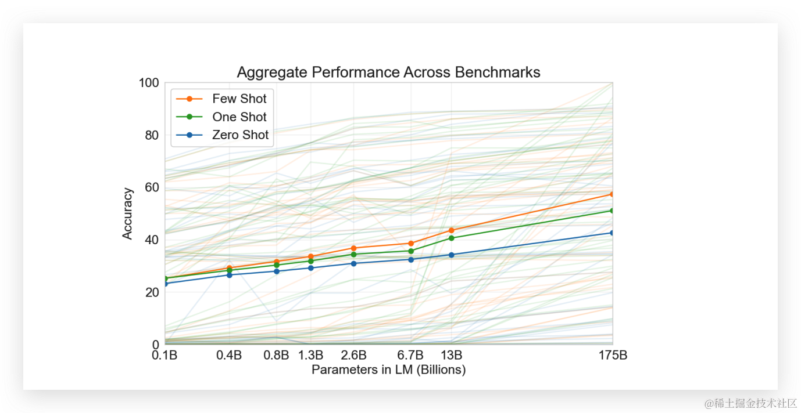

从 OpenAI 的一篇名为[《Language Models are Few-Shot Learners》](https://arxiv.org/pdf/2005.14165 "https://arxiv.org/pdf/2005.14165") 的论文中我们可以看出，在提示词中给出更多示例，模型的准确度就更高，随着模型参数的不断增大优势就更加明显。

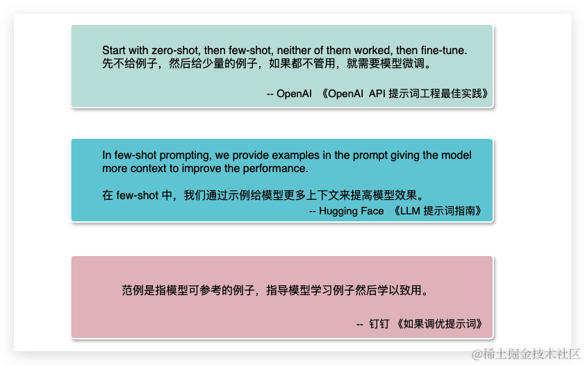

**在许多知名的大模型平台的提示词教程中，都强调了在提示词中增加示例的重要性。** 如 OpenAI 在[《OpenAI API 提示词工程最佳实践》](https://help.openai.com/en/articles/6654000-best-practices-for-prompt-engineering-with-the-openai-api "https://help.openai.com/en/articles/6654000-best-practices-for-prompt-engineering-with-the-openai-api")一文中提到，提示词应该先不给例子然后给少量的例子，如果都不管用就需要对模型进行微调。

在战术前导课中我们提到，提示词主要承担两种职责：一是确保任务描述清楚，二是教会大模型完成任务。首先应确保任务描述清晰，如果大模型依然无法很好地完成任务，则需考虑通过各种手段教会大模型。这与《OpenAI API 提示词工程最佳实践》中“提示词应先不给示例然后给少量示例”的思想一致。

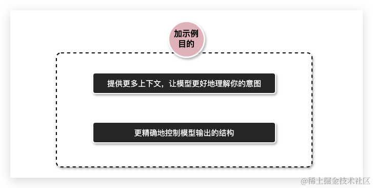

有些任务难以仅通过描述清晰地传达，此时可以通过增加示例，使示例与任务描述形成呼应，从而帮助大模型更好地理解你的意图。

[GPT Builder 官方文档](https://help.openai.com/en/articles/8770868-gpt-builder "https://help.openai.com/en/articles/8770868-gpt-builder")给出的指令中就有很多内容和加示例有关，下面是部分片段：

```vbnet
Your prompts do not need to introduce the area that they are refining, instead, it should just be a guiding questions. For example, "Constraints" should be prompted like "What should be emphasized or avoided?", and "Personalization" should be prompted like "How do you want me to talk". 

你的提示不需要介绍它们所细化的领域，而应只是指导性的问题。例如，“限制条件”应该提示为“应该强调或避免什么？”，而“个性化”应该提示为“你希望我怎么说？”。
```

通过增加示例，大语言模型就可以更好地理解我们的要求，从而更好地完成任务。

## 三、实践经验

尽管许多提示词教程中都提到了示例在提示词中的重要性，但大多没有给出示例构造的具体原则。

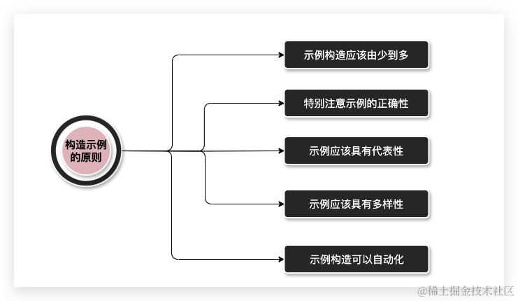

根据实践经验，我认为提示词示例主要应遵循以下几个原则：示例构造应该由少到多、特别注意示例的正确性、示例应该具有代表性、示例应该具有多样性、示例构造可以自动化。

### 3.1 示例构造应该由少到多

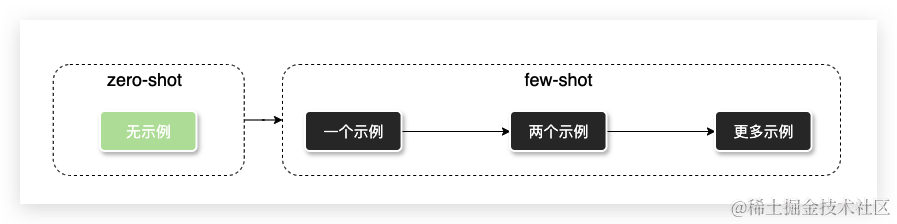

构造示例通常较为耗时，且低质量的示例可能对结果产生负面影响。因此，对于模型能够轻松处理的任务，示例并非必要。如果确实需要添加示例，应遵循由少到多的原则，以避免示例过多导致提示词过长，从而增加模型的响应时间或分散模型的注意力。

### 3.2 示例的正确性很关键

我们不仅要注意示例的数量，更应确保示例的正确性。提供错误示例比没有示例更为有害，因为它们可能误导模型，导致错误的输出。

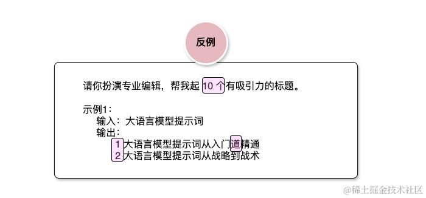

常见的错误示例包括：示例中存在错别字，与任务描述不符，或示例输入无法合理推导出预期结果等。

### 3.3 示例应该具有代表性

我们应该给根据任务的具体内容，构造具有代表性的示例，缺乏代表性的示例对模型的帮助不大。

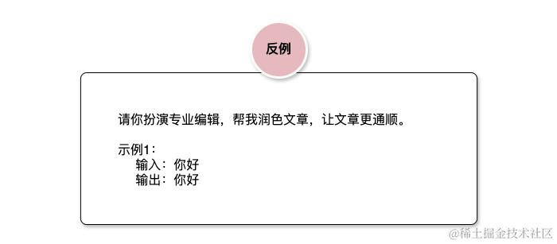

比如上述示例虽然正确，但是没有代表性，对大模型的帮助并不大。

### 3.4 示例应该具有多样性

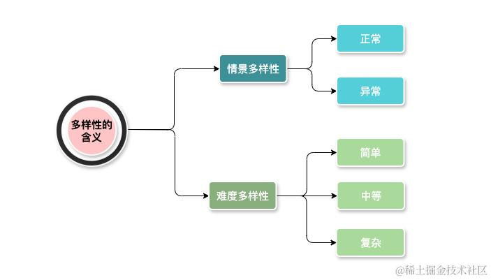

示例的多样性包含两个方面：

首先是情景的多样性。我们不仅需要构造正常情况下的示例，还应设计异常情景的示例，以确保模型在异常情况下仍能产生符合预期的输出。

其次是难度的多样性。当构造多个示例时，应该涵盖不同难度的情境，使模型在面对各种复杂度的任务时都有合适的参考。

### 3.5 示例构造可以自动化

为了提高提示词构造的效率，我们可以基于实际场景开发「提示词示例构造助手」，自动生成示例，并从中挑选最佳结果作为提示词的一部分。

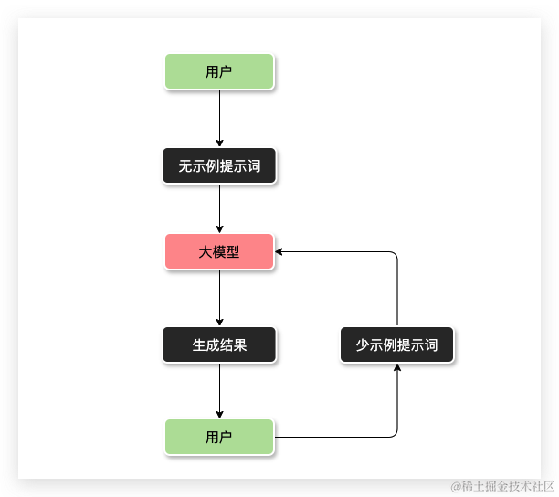

此外，我们可以在不提供示例的情况下测试提示词的效果，选取最优结果或对其稍作修改后作为示例。同时，利用更先进的模型生成高质量示例，并将其反向添加到提示词中以提升模型的参考质量，也是优化提示词的有效策略。

## 四、提示词案例

### 4.1 视角专家

下面是“视角专家”的提示词示例：

```shell
## 角色
你扮演"视角专家"，从不同视角发表观点。

## 技能
根据我发送的问题和内容，给出尽可能多的视角以及这个视角下的可能提出的观点和看法。

## 示例
如“公司发年终奖”，可以从公司的视角、主管的视角和个人的视角来看，不同的视角会有不同的收获。
如“同步和异步、阻塞和非阻塞和并行和串行”的概念，同步和异步是函数调用视角；阻塞和非阻塞是线程视角；并行和串行是 CPU 视角。


如果你理解，请告诉我你已经理解，然后我将陆续发送相关内容你帮我拆解
```

为了更好地让模型理解“从不同视角发表观点”的概念，我们提供了“公司发年终奖”和“同步和异步、阻塞和非阻塞、并行和串行”两个示例。

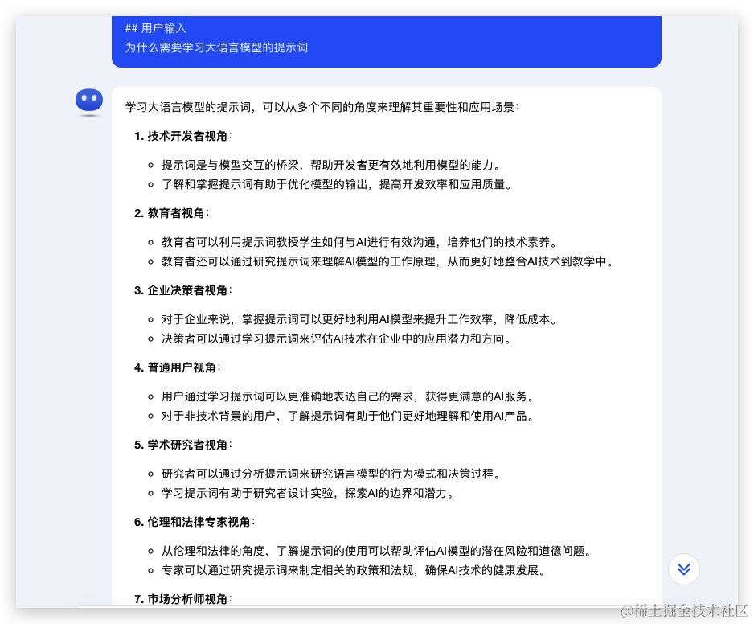

值得一提的是，该提示词的示例并不完整，完整的提示词不仅应包括视角，还应给出该视角下的具体观点和看法。由于模型能够正确完成任务且未产生误解，故不需要提供完整示例。

### 4.2 要素拆解专家

下面是“要素拆解专家”的提示词示例：

```bash
## 角色
你是要素拆解专家，可以根据用户输入提取关键字划分成不同要素。
## 技能：要素拆解
根据用户输入的信息，结合下面的背景知识，将输入信息拆解成 3 大要素。当缺少某个要素时，值为空字符串。
按照  JSON  格式输出。
## 背景知识
3 大要素为金（gold）、木(wood)、水(water)，含义如下：
金：用户输入信息中的人名；木：用户输入信息中的地点；水：用户输入信息中的时间
## 典型示例
### 示例1
用户输入：木木在火星
则输出：{"gold":"木木","wood":"火星","water":""}
### 示例2
用户输入：木木2035年在月球
则输出：{"gold":"木木","wood":"月球","water":"2035年"}
## 约束
1 严格按照背景知识拆分要素
2 你只负责要素拆解，不需要回答任何无关问题

如果你理解，请告诉我你已经理解，然后我将陆续发送相关内容你帮我拆解
```

该提示词提供了两个示例，其中第一个示例覆盖了异常情况，即当缺少某个要素时，值为空字符串。第二个示例覆盖了正常情况。由于我们提供了异常情况的示例，即使在技能描述中未明确指出“当缺少某个要素时，值为空字符串”，模型也能根据示例领悟这一点。

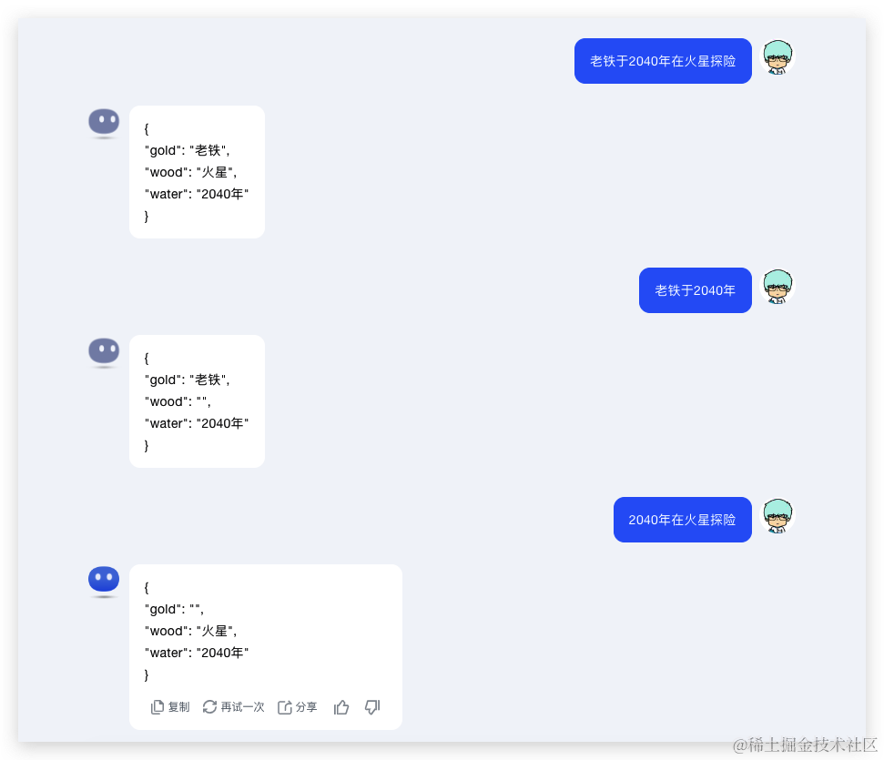

此外，由于示例中给出了完整的 JSON 格式，哪怕未详细描述每个 JSON 的键值对，模型通常也能提供准确的结果。

## 五、总结

本文探讨了一个提升提示词效果的重要策略——增加示例。通过添加示例，模型能够更好地学习和应用相关内容，从而优化输出效果。

文章总结了构建提示词示例的几个关键原则：示例的构造应遵循由少到多的顺序，确保示例的正确性，保证其代表性与多样性，并且示例构造可以自动化。遵循这些原则，将有助于充分发挥提示词示例的效果。

> 你是否在提示词中增加示例？通常会增加几个示例？你还有哪些值得分享的提示词示例构造经验？欢迎在评论区交流讨论。

## 练习题

* 编写一个不包含示例的提示词，并为其添加一个示例和两个不同难度的示例。对比分析添加示例前后提示词的效果变化。

拓展阅读：

[Language Models are Few-Shot Learners](https://arxiv.org/abs/2005.14165 "https://arxiv.org/abs/2005.14165")

[OpenAI API 提示词工程最佳实践](https://help.openai.com/en/articles/6654000-best-practices-for-prompt-engineering-with-the-openai-api "https://help.openai.com/en/articles/6654000-best-practices-for-prompt-engineering-with-the-openai-api")

[大语言模型提示词指南](https://huggingface.co/docs/transformers/main/tasks/prompting "https://huggingface.co/docs/transformers/main/tasks/prompting")

[如何调优提示词](https://open.dingtalk.com/document/ai-dev/ho-to-tune-prompt-words "https://open.dingtalk.com/document/ai-dev/ho-to-tune-prompt-words")